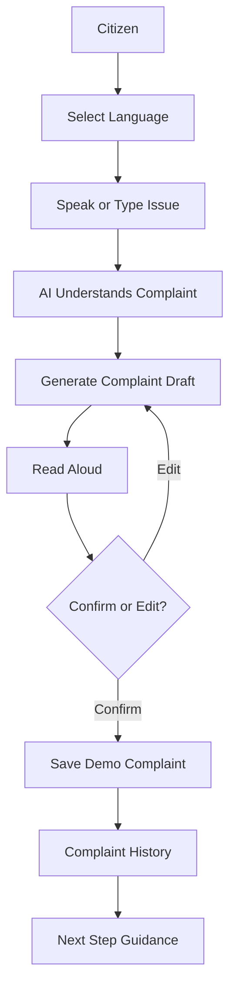
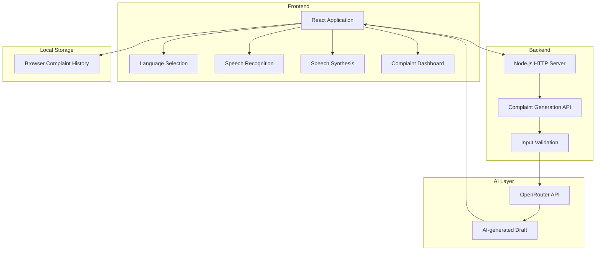
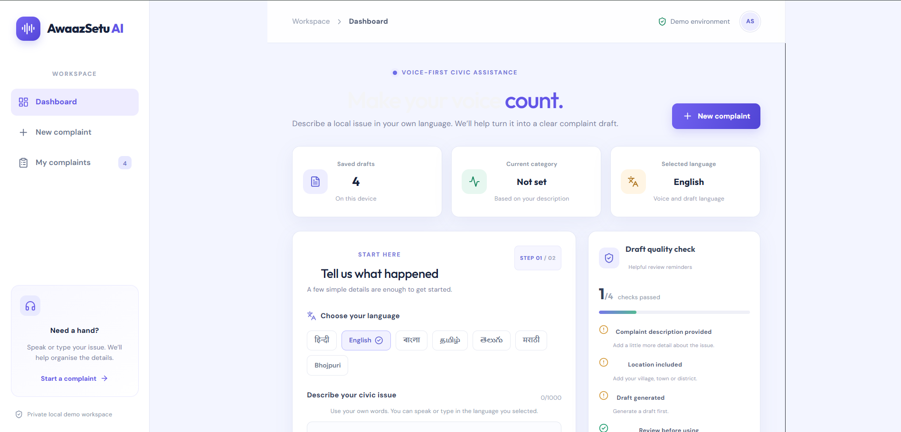
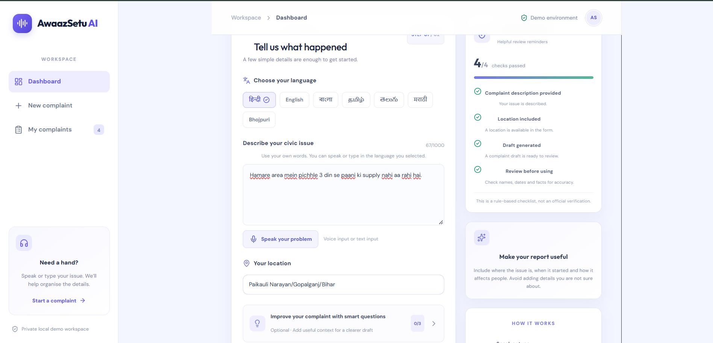
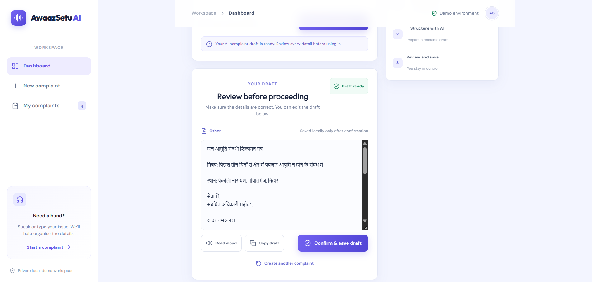
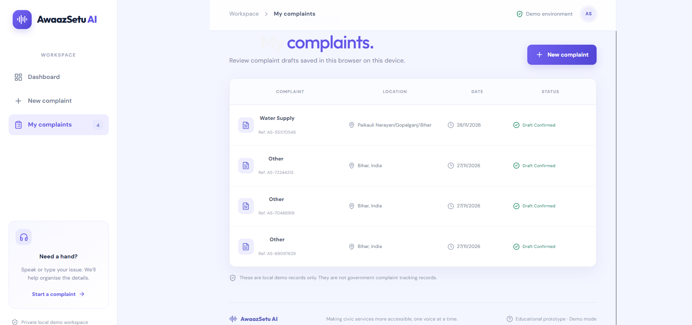

# 🗣️ AwaazSetu AI
### Making Civic Services Accessible Through Every Indian Voice

<p align="center">
  <strong>A multilingual, voice-first AI assistant that helps citizens understand, prepare, and organize civic complaints in their preferred language.</strong>
</p>

<p align="center">
  
  
  
</p>

<p align="center">
  
  
  
  
  
  
</p>

---

## 🌍 The Problem

Millions of people face difficulties accessing civic services because of language barriers, complicated complaint processes, and limited digital literacy.

For many citizens, explaining a local civic issue through a digital form can be challenging.

**AwaazSetu AI aims to make that process simpler through voice and AI.**

## 💡 Our Solution

AwaazSetu AI is a multilingual, voice-first civic assistance platform.

Citizens can describe a civic problem in their preferred language. The application helps convert that description into a structured complaint, lets users review it, and provides guidance for the next steps.

Our goal is simple:

**Your voice. Your language. Your civic access.**

## ✨ Key Features

| Feature | Description |
|---|---|
| 🎙️ Voice Input | Describe civic issues using microphone input |
| 🌐 Multilingual Interface | Switch between supported language options |
| 🤖 AI Complaint Drafting | Generate structured complaint drafts using OpenRouter |
| 📝 Manual Editing | Review and edit complaint details before confirmation |
| 🔊 Read Aloud | Listen to the generated complaint |
| 📂 Complaint History | View locally saved demo complaints |
| 🛡️ Demo Fallback | Continue using local demo mode without an API key |
| 📱 Responsive UI | Designed for desktop and smaller screens |

## 🧭 How It Works




## 🏗️ System Architecture



## 🛠️ Technology Stack

**Frontend**
- React
- Vite
- JavaScript
- CSS3
- Lucide React

**Backend**
- Node.js
- Native HTTP server
- JSON API

**AI Integration**
- OpenRouter API
- Configurable language model

**Browser Capabilities**
- Web Speech API
- Speech Synthesis API
- LocalStorage

**Deployment Configuration**
- Docker
- Docker Compose

## 🚀 Getting Started

### 1. Clone the repository

```bash
git clone https://github.com/arish096/AwaazSetu-AI.git
cd AwaazSetu-AI
```

### 2. Install dependencies

```bash
npm install
```

### 3. Configure environment variables

Create a `.env` file in the project root:

```env
OPENROUTER_API_KEY=
OPENROUTER_MODEL=openrouter/free
PORT=5000
```

The API key is optional. Keep it empty to use the demo fallback.

To enable AI generation, add your own OpenRouter API key locally.

**Never commit your `.env` file or expose your API key.**

### 4. Start the backend

Open a terminal:

```bash
npm run server
```

Backend:

`http://localhost:5000`

Health check:

`http://localhost:5000/api/health`

### 5. Start the frontend

Open a second terminal:

```bash
npm run dev
```

Frontend:

`http://localhost:5173`

## 🔐 Environment Variables

| Variable | Description | Required |
|---|---|---|
| `OPENROUTER_API_KEY` | OpenRouter API key | No |
| `OPENROUTER_MODEL` | AI model identifier | No |
| `PORT` | Backend server port | No |

## 🐳 Docker Configuration

Docker configuration files are included:

- `Dockerfile`
- `Dockerfile.backend`
- `docker-compose.yml`
- `.dockerignore`

When Docker is installed and configured, start the services with:

```bash
docker compose up --build
```

Stop the services:

```bash
docker compose down
```

**Note:** Docker deployment configuration is included but has not yet been verified on a running Docker environment. The application can also be run locally without Docker.

## 🔒 Privacy & Responsible AI

- Users should review generated complaint drafts before confirming.
- AI-generated content may require correction.
- The application should not invent missing complaint details.
- API credentials must remain in local environment variables.
- Complaint history currently uses browser LocalStorage.
- Demo complaint confirmation does not submit a complaint to a government department.

## ⚠️ Current Scope & Limitations

AwaazSetu AI is currently a prototype.

- Complaint records are saved locally in the browser.
- No official government complaint API integration is claimed.
- The application provides guidance rather than guaranteed complaint submission or tracking.
- Voice recognition depends on browser and device support.
- Bhojpuri speech recognition may use Hindi recognition as a fallback.
- AI generation requires a configured API key; otherwise, demo fallback is available.

## 🗺️ Roadmap

- [x] Voice-first complaint interface
- [x] Language selection
- [x] AI-assisted complaint drafting
- [x] Read-aloud functionality
- [x] Local demo complaint history
- [x] Demo fallback without API credentials
- [x] Docker configuration files
- [ ] Complete Docker deployment testing
- [ ] More regional language testing
- [ ] Accessibility and real-world usability testing
- [ ] Explore verified civic-service integrations

## 🎯 Vision

We believe language should never become a barrier between citizens and essential civic services.

AwaazSetu AI explores how voice technology and responsible AI can make civic assistance more approachable, understandable, and inclusive.

**Every voice deserves to be heard.**

---

## 📸 Application Preview

### Homepage


### AI Complaint Generation



### Complaint History


## 🎬 Demo Video

[](https://youtu.be/ItABE19O6os)

▶️ **[Watch AwaazSetu AI Demo on YouTube](https://youtu.be/ItABE19O6os)**

## 👨‍💻 Author

**Arish Islam**

Student Developer | Web Development | AI & Prompt Engineering

- GitHub: [@arish096](https://github.com/arish096)

---

<p align="center">
  <strong>🗣️ AwaazSetu AI — Making Civic Services Accessible Through Every Indian Voice.</strong>
</p>
